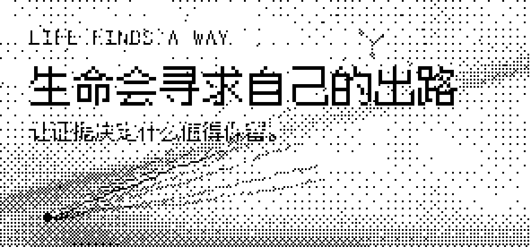
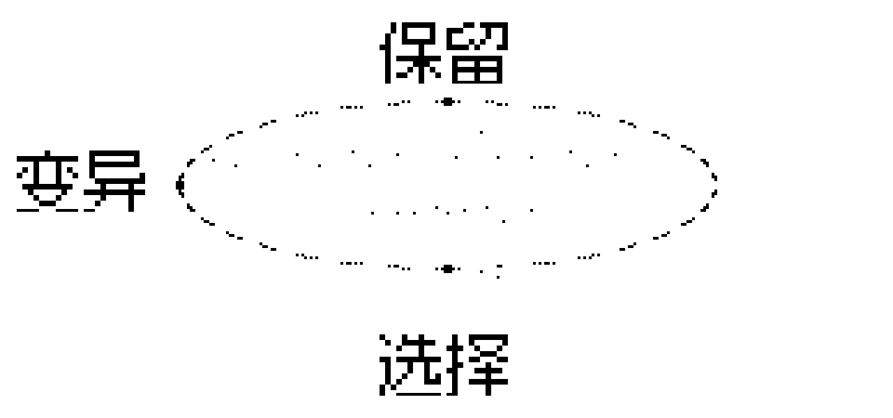

<div align="center">

<picture>
  <source media="(prefers-color-scheme: dark)" srcset="./assets/hero-banner-dark.png">
  <source media="(prefers-color-scheme: light)" srcset="./assets/hero-banner-light.png">
  
</picture>

**Open paths. Bound autonomy. Let evidence select.**

**生命会寻求自己的出路 —— 证据驱动的自主研发选择层**

> **当前状态：`NOT_PROVEN` — 方法有效性仍待直接对照实验检验。**
> 这个仓库目前提供的是理念、契约与原则，以及相应的展示层；它不声称已经提升研发能力。

[它解决什么问题](#problem) · [它提供什么](#provides) · [它不是什么](#not) · [证据状态](#evidence) · [阅读路径](#reading-path) · [研发宪章](./CHARTER.md)

<sub>AI Coding 自主探索与持续验证研发理念 · v1.0 · 制定于 2026-10-13 · 首页定位更新于 2026-10-28</sub>

</div>

---

## 这是什么

**Life Finds a Way 不是新的 Agent 框架，也不声称已经证明自身有效。**
它提供**研发宪章、任务契约和证据选择原则**，用于规定：

- **人类**如何定义使命、资源与权限边界；
- **Agent** 如何自主探索并质疑预设路径；
- **实验**如何决定接受、回退、转向或停止；
- **哪些经验**未来才有资格成为可复用资产。

**我负责提出值得解决的问题，AI 负责探索可能的道路，真实世界负责给出反馈。**

<a id="problem"></a>
## 它解决什么问题

**过去我把未经验证的方案，伪装成了任务本身。** 我指定架构、框架、组件和实现步骤，AI 按我的方案工作，遇到障碍就继续修这条路线——这可以交付代码，却未必能解决最初的问题。

| 不再这样写 | 改为这样写 |
| :--- | :--- |
| 用指定框架重构现有系统<br>按我设计的分层架构实现若干模块<br>依次开发 A、B、C，最后运行测试 | 先核对现有系统与真实瓶颈<br>自主研究并选择最有希望的解决路径<br>以最小、可证伪的实验验证方案<br>可以反驳我的初始假设 |

除非这些实现手段本身就是任务目的，否则前者往往是在让 AI 优化我预先选择的路径。

<a id="provides"></a>
## 它目前实际提供什么

| 内容 | 位置 | 状态 |
| :--- | :--- | :--- |
| **研发宪章**：人机分工、探索闭环、自主边界与自律清单的完整成文 | [CHARTER.md](./CHARTER.md) | v1.0（2026-10-13） |
| **任务契约**：可直接复制的通用任务模板 | 本页[任务契约](#contract)，与宪章第六节同源 | 已成文 |
| **证据选择原则**：变异 → 选择 → 保留；如实保留 `PASS` `FAIL` `BLOCKED` `INCONCLUSIVE` `NOT_PROVEN` | [CHARTER.md](./CHARTER.md) · 本页 | 已成文 |
| **展示层**：离线叙事页、1-bit 设计语言、可复现的生成工具 | [index.html](./index.html) · [docs/design-language.md](./docs/design-language.md) | 已建成 |
| **方法有效性** | —— | **`NOT_PROVEN`**：仍待直接对照实验检验 |
| 可运行框架 / CLI / 正式技能 | —— | 尚不存在；v0.2 技能仅为[候选版（未合并）](https://github.com/Anhao1314/life-finds-a-way/pull/3) |

<a id="not"></a>
## 它不是什么

- **不是新的 Agent 框架、CLI 或工具库。** `main` 分支上没有可安装的运行时代码。
- **不是已被证明有效的方法。** 当前状态是 `NOT_PROVEN`；宪章与原则是**工作假设**，可被未来证据修正甚至推翻。
- **不是成功案例集。** 证据板保留的主要是失败、受阻与未知。
- **不是「AI 已经具有生命」的主张。**「生命会寻求自己的出路」借用的是**变异 → 选择 → 保留**这一探索与选择的机制，而不是关于生命或意识的断言。

<a id="evidence"></a>
## 当前证据状态

> **`NOT_PROVEN` — 方法有效性仍待直接对照实验检验。**

**第一个直接对照实验：预注册草案** → [`experiments/0001-open-path-selection`](./experiments/0001-open-path-selection/preregistration.md)——已设计，**未运行**；执行前需所有者确认模型与预算。设计实验不构成有效性证据，方法状态仍为 `NOT_PROVEN`。

下面三项经历促成了这套思想。它们是**思想的来源与相关实践证据**，**不是** LFAW 方法有效性的直接证明——它们都发生在这份宪章确立之前。

| 8/10 vs 7/10 | 保留失败 | 工程 PASS ≠ 价值成立 |
| :--- | :--- | :--- |
| [Deep Native](https://github.com/Anhao1314/deep-native/blob/main/docs/v0.1-pilot-findings.md)：10 组完整配对中，原始 DeepSeek 完成 **8/10**，启用技能后 **7/10**；工具调用中位数由 **29** 增至 **36**。<br>小样本不能否定所有技能，却足以反对「流程越多效果越好」的直觉。 | [G1 具身研究](https://github.com/Anhao1314/g1-jev-swarm-lab/blob/main/docs/lab-notebook/negative-results.md)：严格失败、授权拒绝与未证明的可靠性必须被记录。<br>`PASS` `FAIL` `BLOCKED` `INCONCLUSIVE` `NOT_PROVEN` | [FlowCredit](https://github.com/Anhao1314/flowcredit-research)：报告生成、工程跑通和模型调用次数，都不能替代真实用户价值。<br>瓶颈可能在模型，也可能在数据、工具、授权或交互。 |

**工作量不等于能力增长；工程上的 PASS 不自动等于真实世界里的成功。**

[**阅读完整故事：五个阶段、具体失败与反思 →**](./docs/origin-story.md)

<a id="reading-path"></a>
## 新读者接下来读什么

按目的选择入口，全部可从本页直达：

1. **想理解方法** → [CHARTER.md](./CHARTER.md)：完整研发宪章——人机分工、探索闭环、边界与每轮要回答的五个问题。
2. **想知道它从哪来** → [docs/origin-story.md](./docs/origin-story.md)：真实失败与反思的完整记录。
3. **想直接用** → 本页[任务契约](#contract)；想以技能形式调用，见 v0.2 [候选版 PR #3](https://github.com/Anhao1314/life-finds-a-way/pull/3)（尚未合并至 `main`）。
4. **想看视觉与设计** → [index.html](./index.html)（可离线打开的叙事页）· [docs/design-language.md](./docs/design-language.md)（完整设计说明）。
5. **想核对历史** → [CHANGELOG.md](./CHANGELOG.md)（修订记录）· [history/2026-10-13_v1.0.md](./history/2026-10-13_v1.0.md)（v1.0 原始快照）。

---

<a id="contract"></a>
## 任务契约

把宪章变成可以直接粘贴到任务开头的契约。**越熟悉的任务，Prompt 越短；越高风险的任务，边界和验收越具体。**

<details>
<summary><b>可复制的通用任务模板</b></summary>

```text
你是本任务的自主研究者与工程负责人。

使命：[真正要解决的问题与价值]
现状：[真实基线、已有资产和已知失败]
资源：[可用时间、计算、预算、工具]
边界：[不能修改、不能消费、需要另行授权的事项]
验收：[能观察、复现、比较的结果]

请自己判断最有希望的道路。可以质疑我的方案，
优先提出并实施最小的判别实验，不为了完成计划而维持错误路线。
在授权内主动推进，遇到明确边界再申请批准。
最终报告事实、证据、失败、成本，以及接受/回退/转向的建议。
```

</details>

**想直接调用技能？** v0.2 候选版见 [PR #3](https://github.com/Anhao1314/life-finds-a-way/pull/3) 与 [安装说明（开发分支）](https://github.com/Anhao1314/life-finds-a-way/blob/feat/v0.2-agent-skill/docs/skill-guide.md)。安装后，Codex 使用 `$life-finds-a-way`，Claude Code 使用 `/life-finds-a-way`。

> **注意：** v0.2 技能尚未合并至 `main`，本页不将其计为已交付内容。部分第三方 Claude 桌面端需要在应用的「设置 → 技能」中单独导入；在终端安装成功，不代表桌面端一定能发现。

## 进化闭环

<div align="center">

<picture>
  <source media="(prefers-color-scheme: dark)" srcset="./assets/loop-dark.png">
  <source media="(prefers-color-scheme: light)" srcset="./assets/loop-light.png">
  
</picture>

</div>

**明确使命 → 探索不同道路 → 尝试证伪 → 证据判断 → 保留有效改变**

| 阶段 | 做什么 |
| :--- | :--- |
| **变异 Variation** | 提出多条真正不同的解决路径，不被第一种想法锁定。 |
| **选择 Selection** | 用真实任务、对照实验、资源成本与独立评测筛选方案。 |
| **保留 Retention** | 把被证明有效的能力、经验、工具或模型版本纳入基线；无效方案保留失败证据，但不继续浪费资源。 |

落到每个任务上，它就是四条很朴素的纪律：

- **定义问题**：核对真实基线、资源与验收条件，不把猜测当事实。
- **开放路径**：允许 AI 质疑预设方案，优先复用现有资产和更简单的办法。
- **最小验证**：在必要时设计能暴露错误假设的实验，保留失败和未知。
- **证据选择**：根据结果与成本，接受、回退、换路或停止。

没有可靠的选择机制，所谓「自进化」只是不断增加代码、复杂度或上下文。

**它不是强制四步流程。** 一行代码能解决的问题，就不需要多 Agent、复杂计划和长篇实验报告。

## 自主的边界

| 可以 | 不能 |
| :--- | :--- |
| 方法可以改变 | 权限不能自行扩大 |
| 证据可以推翻方案 | 不能为了方案改写证据 |
| Agent 可以探索 | 人仍对使命与接受结果负责 |

**需要另行授权：** GPU 推理或训练 · 付费 API · 模型与大规模数据下载 · 生产部署 · 公开发布 · 密钥与权限变更 · 破坏性操作 · 正式数据写入 · 冻结证据修改。

研究、只读审查、既定范围内的开发和 CPU 测试，可以在当前授权下主动推进。

### 模型适用范围

现阶段优先面向擅长高阶推理与自主规划的模型，例如 GPT-6 Astra、Claude 的高级推理配置等。轻量模型应缩小任务范围、明确必要约束并增加人工检查。

**这只是当前使用边界，不是已经被对照实验确认的模型能力分界线。** 使用高级模型也不保证结果更好。

---

<details>
<summary><b>展示层与设计（index.html · assets · tools）</b></summary>

- [**index.html**](./index.html) —— 可离线打开的叙事页（场景化滚动、像素字体、抖动网点美术）。本地预览：`python -m http.server`，然后访问 `http://127.0.0.1:8000/`。
- [**docs/design-language.md**](./docs/design-language.md) —— 完整设计语言：两种颜色、一种像素字体、缓动与动效参数。
- [**tools/make_art.py**](./tools/make_art.py) —— 全部背景与示意图的生成器（Bayer 8×8 有序抖动量化到 1-bit，可复现）。
- [**tools/build_font.py**](./tools/build_font.py) —— 把页面用到的字形从 [Fusion Pixel 12px Mono](https://github.com/TakWolf/fusion-pixel-font)（OFL-1.1）子集出来，15 KB 而不是 4.6 MB。
- [**tools/make_gif.py**](./tools/make_gif.py) —— 合成 `assets/media/journey.gif`（README 首页不再展示该动图，文件保留在仓库中）。

原则很简单：**能由脚本生成的，就不放进仓库；不能复现的装饰，就不加。**

</details>

## License

本仓库自有内容以 [MIT](./LICENSE) 许可发布：Copyright (c) 2026 Anhao1314。

第三方资产继续遵循各自已有许可证，本仓库的 MIT 许可不改变其授权条款——例如子集化自 [Fusion Pixel 12px Mono](https://github.com/TakWolf/fusion-pixel-font)（OFL-1.1）的字体，许可全文见 [`assets/fonts/LICENSE-OFL.txt`](./assets/fonts/LICENSE-OFL.txt)。

---

<div align="center">

**生命会寻求自己的出路。**

*让证据决定什么值得保留。*

<sub>开放路径 · 严守边界 · 忠于证据</sub>

</div>
