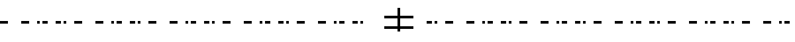
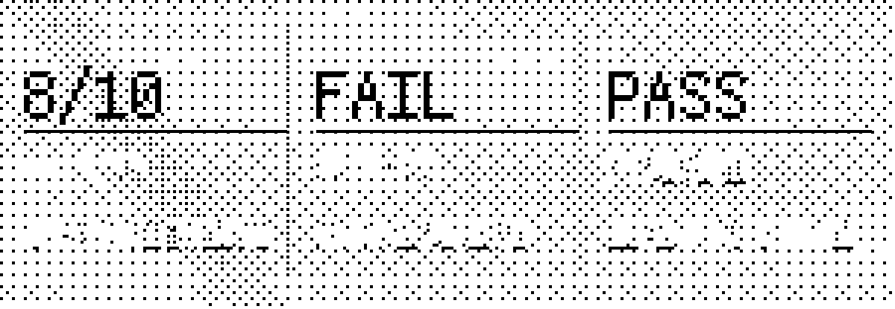

<div align="center">

<picture>
  <source media="(prefers-color-scheme: dark)" srcset="./assets/hero-banner-dark.png">
  <source media="(prefers-color-scheme: light)" srcset="./assets/hero-banner-light.png">
  
</picture>

**我负责提出值得解决的问题，AI 负责探索可能的道路，真实世界负责给出反馈。**

[提问的方式](#ask) · [我的转变](#journey) · [进化闭环](#loop) · [证据板](#evidence) · [自主的边界](#bounds) · [读宪章](./CHARTER.md)

<sub>AI Coding 自主探索与持续验证研发理念 · v1.0 · 制定于 2026-10-13</sub>

</div>

> **这是一份持续修订的工作假设**，不是新的编程智能体框架，也不是已被证明能够普遍提高开发效率的方法。保留失败、保留 `INCONCLUSIVE`、保留"还不知道"。

<div align="center">

<picture>
  <source media="(prefers-color-scheme: dark)" srcset="./assets/divider-dark.png">
  <source media="(prefers-color-scheme: light)" srcset="./assets/divider-light.png">
  
</picture>

</div>

<a id="ask"></a>
## 01 · 提问的方式

**过去我把未经验证的方案，伪装成了任务本身。** 我指定架构、框架、组件和实现步骤，AI 按我的方案工作，遇到障碍就继续修这条路线——这可以交付代码，却未必能解决最初的问题。

| 不再这样写 | 改为这样写 |
| :--- | :--- |
| 用指定框架重构现有系统<br>按我设计的分层架构实现若干模块<br>依次开发 A、B、C，最后运行测试 | 先核对现有系统与真实瓶颈<br>自主研究并选择最有希望的解决路径<br>以最小、可证伪的实验验证方案<br>可以反驳我的初始假设 |

除非这些实现手段本身就是任务目的，否则前者往往是在让 AI 优化我预先选择的路径。

<details>
<summary><b>可复制的通用任务模板</b></summary>

```text
你是本任务的自主研究者与工程负责人。

使命：[真正要解决的问题与价值]
现状：[真实基线、已有资产和已知失败]
资源：[可用时间、计算、预算、工具]
边界：[不能修改、不能消费、需要另行授权的事项]
验收：[能观察、复现、比较的结果]

请自己判断最有希望的道路。可以质疑我的方案，
优先提出并实施最小的判别实验，不为了完成计划而维持错误路线。
在授权内主动推进，遇到明确边界再申请批准。
最终报告事实、证据、失败、成本，以及接受/回退/转向的建议。
```

**越熟悉的任务，Prompt 越短；越高风险的任务，边界和验收越具体。**

</details>

**想直接调用技能？** v0.2 候选版见 [PR #3](https://github.com/Anhao1314/life-finds-a-way/pull/3) 与 [安装说明（开发分支）](https://github.com/Anhao1314/life-finds-a-way/blob/feat/v0.2-agent-skill/docs/skill-guide.md)。安装后，Codex 使用 `$life-finds-a-way`，Claude Code 使用 `/life-finds-a-way`。

> **注意：** v0.2 技能尚未合并至 `main`。部分第三方 Claude 桌面端需要在应用的「设置 → 技能」中单独导入；在终端安装成功，不代表桌面端一定能发现。

<a id="journey"></a>
## 02 · 我的转变

这套思想不是从成功案例里挑出来的口号，而是我从反复走过的弯路里收回来的判断。

<details>
<summary><b>五个阶段：从一个"更详细的提示词"开始</b></summary>

**01 / 以为提示词越详细越可靠。** 我替 AI 选框架、画架构、拆任务，却常常把未经验证的技术方案当作问题本身。

**02 / 工程不断推进，目标却越来越远。** 我花时间处理依赖、接口和工作流，逐渐分不清自己是在解决用户问题，还是在维护原先选定的路线。

**03 / 实验开始反驳我的直觉。** Deep Native 的小规模配对、G1 的严格失败，以及 FlowCredit 的真实价值问题，都提醒我：完成更多工作，不等于获得更强能力。

**04 / 我开始反过来问。** 为什么总是先指定「怎么做」，却很少允许 AI 判断「是否值得这样做」？

**05 / 2026.10.13：生命会寻求自己的出路。** 我决定先定义值得抵达的地方和不能突破的边界，让智能探索道路，让实验决定哪些改变值得留下。

</details>

> **以前，我常常先选道路，再要求 AI 证明它走得通。现在，我想让证据来选择道路。**

[**阅读完整故事：五个阶段、具体失败与我的反思 →**](./docs/origin-story.md)

<a id="loop"></a>
## 03 · 进化闭环

<div align="center">

<picture>
  <source media="(prefers-color-scheme: dark)" srcset="./assets/loop-dark.png">
  <source media="(prefers-color-scheme: light)" srcset="./assets/loop-light.png">
  
</picture>

</div>

**明确使命 → 探索不同道路 → 尝试证伪 → 证据判断 → 保留有效改变**

| 阶段 | 做什么 |
| :--- | :--- |
| **变异 Variation** | 提出多条真正不同的解决路径，不被第一种想法锁定。 |
| **选择 Selection** | 用真实任务、对照实验、资源成本与独立评测筛选方案。 |
| **保留 Retention** | 把被证明有效的能力、经验、工具或模型版本纳入基线；无效方案保留失败证据，但不继续浪费资源。 |

落到每个任务上，它就是四条很朴素的纪律：

- **定义问题**：核对真实基线、资源与验收条件，不把猜测当事实。
- **开放路径**：允许 AI 质疑预设方案，优先复用现有资产和更简单的办法。
- **最小验证**：在必要时设计能暴露错误假设的实验，保留失败和未知。
- **证据选择**：根据结果与成本，接受、回退、换路或停止。

没有可靠的选择机制，所谓「自进化」只是不断增加代码、复杂度或上下文。

**它不是强制四步流程。** 一行代码能解决的问题，就不需要多 Agent、复杂计划和长篇实验报告。

<a id="evidence"></a>
## 04 · 证据板

<div align="center">

<picture>
  <source media="(prefers-color-scheme: dark)" srcset="./assets/evidence-dark.png">
  <source media="(prefers-color-scheme: light)" srcset="./assets/evidence-light.png">
  
</picture>

</div>

| 8/10 vs 7/10 | 保留失败 | 工程 PASS ≠ 价值成立 |
| :--- | :--- | :--- |
| [Deep Native](https://github.com/Anhao1314/deep-native/blob/main/docs/v0.1-pilot-findings.md)：10 组完整配对中，原始 DeepSeek 完成 **8/10**，启用技能后 **7/10**；工具调用中位数由 **29** 增至 **36**。<br>小样本不能否定所有技能，却足以反对「流程越多效果越好」的直觉。 | [G1 具身研究](https://github.com/Anhao1314/g1-jev-swarm-lab/blob/main/docs/lab-notebook/negative-results.md)：严格失败、授权拒绝与未证明的可靠性必须被记录。<br>`PASS` `FAIL` `BLOCKED` `INCONCLUSIVE` `NOT_PROVEN` | [FlowCredit](https://github.com/Anhao1314/flowcredit-research)：报告生成、工程跑通和模型调用次数，都不能替代真实用户价值。<br>瓶颈可能在模型，也可能在数据、工具、授权或交互。 |

**工作量不等于能力增长；工程上的 PASS 不自动等于真实世界里的成功。**

<a id="bounds"></a>
## 05 · 自主的边界

| 可以 | 不能 |
| :--- | :--- |
| 方法可以改变 | 权限不能自行扩大 |
| 证据可以推翻方案 | 不能为了方案改写证据 |
| Agent 可以探索 | 人仍对使命与接受结果负责 |

**需要另行授权：** GPU 推理或训练 · 付费 API · 模型与大规模数据下载 · 生产部署 · 公开发布 · 密钥与权限变更 · 破坏性操作 · 正式数据写入 · 冻结证据修改。

研究、只读审查、既定范围内的开发和 CPU 测试，可以在当前授权下主动推进。

### 模型适用范围

现阶段优先面向擅长高阶推理与自主规划的模型，例如 GPT-6 Astra、Claude 的高级推理配置等。轻量模型应缩小任务范围、明确必要约束并增加人工检查。

**这只是当前使用边界，不是已经被对照实验确认的模型能力分界线。** 使用高级模型也不保证结果更好。

<div align="center">

<picture>
  <source media="(prefers-color-scheme: dark)" srcset="./assets/divider-dark.png">
  <source media="(prefers-color-scheme: light)" srcset="./assets/divider-light.png">
  
</picture>

</div>

<div align="center">

**生命会寻求自己的出路。**

*让证据决定什么值得保留。*

[**研发宪章**](./CHARTER.md) · [**完整故事**](./docs/origin-story.md) · [**修订记录**](./CHANGELOG.md) · [**v1.0 原始快照**](./history/2026-10-13_v1.0.md)

<sub>开放路径 · 严守边界 · 忠于证据</sub>

</div>

---

<details>
<summary><b>关于这一版展示层</b></summary>

这一版重做了仓库的视觉与阅读路径，**文档内容与结论未作改动**：

- [**`index.html`**](./index.html) —— 可离线打开的叙事页（场景化滚动、像素字体、抖动网点美术）；本地预览：`python -m http.server`，然后访问 `http://127.0.0.1:8000/`。
- [**`docs/design-language.md`**](./docs/design-language.md) —— 设计语言：两种颜色、一种像素字体、缓动与动效参数。
- [**`tools/make_art.py`**](./tools/make_art.py) —— 全部背景与示意图的生成器（Bayer 8×8 有序抖动量化到 1-bit，可复现）。
- [**`tools/build_font.py`**](./tools/build_font.py) —— 只把页面用到的字形从 [Fusion Pixel 12px Mono](https://github.com/TakWolf/fusion-pixel-font)（OFL-1.1）子集出来，15 KB 而不是 4.6 MB；许可证见 [`assets/fonts/LICENSE-OFL.txt`](./assets/fonts/LICENSE-OFL.txt)。

原则很简单：**能由脚本生成的，就不放进仓库；不能复现的装饰，就不加。**

</details>