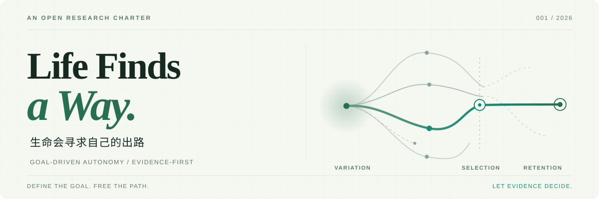

<div align="center">

<picture>
  <source media="(prefers-color-scheme: dark)" srcset="./assets/hero-dark.svg">
  <source media="(prefers-color-scheme: light)" srcset="./assets/hero-light.svg">
  
</picture>

**明确使命 · 开放路径 · 守住边界 · 由证据决定**

*A living research charter for goal-driven AI coding and verifiable progress.*

[**阅读完整宪章 ↗**](./CHARTER.md) · [**复制任务模板 ↗**](#quickstart) · [**查看演进记录 ↗**](./CHANGELOG.md)

</div>

---

## The Idea · 为什么存在

**我负责提出值得解决的问题，AI 负责探索可能的道路，真实世界负责给出反馈。**

很多 AI Coding 任务并不缺代码，缺的是对**问题是否真正解决**的判断。我们太容易提前指定架构、实现顺序和工具，然后投入大量时间维护一条从未被证明值得走的路线。

**Life Finds a Way** 是我给自己确立的一份研发宪章：**目标要清晰，方法可改变；自主探索有边界，进步必须有证据。**

这是一份持续演进的研究与工程实践原则，**不是可安装的软件框架，也不是已被实验证明能提高所有任务效率的结论**。

## The Loop · 让探索产生有效进步

<div align="center">

**MISSION → VARIATION → FALSIFICATION → SELECTION → RETENTION**

*定义使命 → 探索候选路径 → 最小证伪实验 → 证据评审 → 保留有效改进*

</div>

| 环节 | 我们真正要做的事 |
| :-- | :-- |
| **01 · Frame** | 明确用户问题、现实基线、资源预算与不能越过的边界。 |
| **02 · Explore** | 允许 AI 反驳预设方案，寻找更简单或更有效的替代路径。 |
| **03 · Falsify** | 优先开展最小、可复现、能够揭示错误假设的实验。 |
| **04 · Decide** | 对照证据做出 **接受 / 换路 / 停止** 决策，而不靠演示效果投票。 |

`PASS`、`FAIL`、`BLOCKED`、`INCONCLUSIVE` 都是需要如实保存的结果。没有可靠的选择机制，“自进化”就可能只是不断累积复杂度。

## The Rules · 不可妥协的原则

- **Goal over instructions.** 说明想抵达哪里，不预先画死每一条路。
- **Autonomy within boundaries.** AI 可以自主选择方法，不能自行扩大权限、预算或高风险操作范围。
- **Evidence over theater.** 代码行数、调用次数与漂亮演示，不等于可验证的能力增长。
- **Humans remain accountable.** 人负责使命、资源和最终批准，实验负责揭示方案是否有效。

## Quickstart

**把下面这段交给 Coding Agent，先解决一个真实问题。** 不需要为每个小任务都建一套复杂流程。

```text
使命：[真正要解决的用户问题，以及成功时可观察到的变化]
现状：[已核验的系统基线、已有资产、失败记录]
资源：[可用时间、工具、算力、预算]
边界：[不可修改的事实与产物、禁止操作、需另行授权的事项]
验收：[如何比较、复现和证明结果]

请先检查真实基线，自主判断最值得尝试的路径。
允许质疑我的预设方案，优先做最小的判别实验；
在已授权范围内完成实现和验证，不得自行扩大资源或执行权限。
最后交付可核验的结果、失败与未知、实际成本，以及接受/换路/停止的建议。
```

需要更完整的角色分工、七步闭环、授权原则和修订纪律，可读 **[CHARTER.md · 完整研发宪章](./CHARTER.md)**。

## In Practice · 适用场景

这套原则面向真实的 AI 辅助研发，而非特定模型或框架。例如：

- **Agent / 产品开发**：让实际用户问题而非预设架构决定下一次迭代。
- **具身智能 / 科研实验**：保留失败、独立评分和复现实验；不为了得到 `PASS` 改写评价标准。
- **多 Agent 协作**：让方案差异与独立评审创造价值，而非追求更多 Agent 数量。

**重要边界：** GPU 训练、付费 API、大规模下载、生产部署、密钥和权限修改、不可逆操作等，均不因“自主探索”而自动获得授权。详见 [宪章中的授权说明](./CHARTER.md)。

## Reading Room · 原则如何演进

| 文件 | 作用 |
| :-- | :-- |
| [**CHARTER.md**](./CHARTER.md) | 当前有效的完整原则与实践规范 |
| [**CHANGELOG.md**](./CHANGELOG.md) | 每次修订的动机、依据与变化 |
| [**v1.0 原始快照**](./history/2026-10-13_v1.0.md) | 2026-10-13 首次发布版本，保留原貌 |

重要修订需要回答：**发生了什么？改变了哪条判断？什么证据让这次修改值得保留？**

---

<div align="center">

**Life finds a way.**  
*Let evidence decide what survives.*

<sub>Open paths. Hard boundaries. Honest evidence.</sub>

</div>
